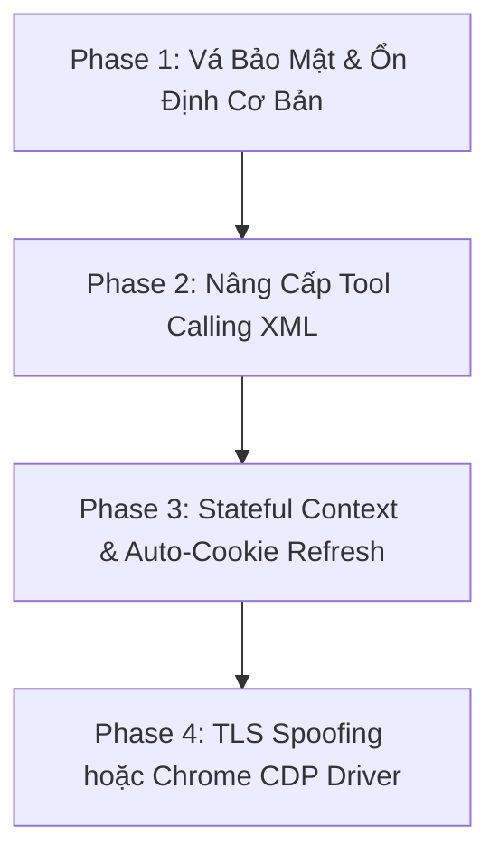

# Kế Hoạch Nghiên Cứu & Cải Tiến Dự Án Gemini Bridge

> **Tài liệu tổng hợp ý tưởng & lộ trình phát triển kỹ thuật (Research & Improvement Roadmap)**  
> *Dành cho dự án học tập, nghiên cứu dịch ngược hệ thống (Reverse-Engineering Sandbox).*

---

## 1. Tổng Quan & Bản Chất Dự Án

### 1.1. Bản chất cốt lõi
* **Gemini Node Bridge** là giải pháp reverse-proxy biến giao diện web người dùng của Google Gemini (`gemini.google.com`) thành một REST API chuẩn **OpenAI-Compatible** (`/v1/chat/completions`, `/v1/models`, `/v1/responses`).
* Khác với các giải pháp chính thức yêu cầu trả tiền cho Google Cloud / Gemini API Key, dự án tận dụng **Session Cookie của trình duyệt cá nhân** (`__Secure-1PSID`, `__Secure-1PSIDTS`) để tái tạo các RPC call (`StreamGenerate`) và trích xuất token bảo mật (`SNlM0e`).
* **Module Probe ([research/gemini-web-probe/](file:///home/kanzune/Projects/Gemini-bridge/research/gemini-web-probe)):** Sandbox sử dụng Puppeteer độc lập nhằm "bắt gói tin" mạng từ browser thật để dịch ngược format gói tin của Google mỗi khi giao diện web cập nhật.

---

## 2. Các Rào Cản Hiện Tại Cần Giải Quyết

1. **Tool Calling hạn chế & dễ gãy:**
   * Hiện tại trong [src/tool-calling.ts](file:///home/kanzune/Projects/Gemini-bridge/src/tool-calling.ts), hệ thống ép Gemini trả về duy nhất 1 JSON object (`Decide whether to call exactly one tool`).
   * Không hỗ trợ gọi nhiều tool cùng lúc (parallel tool calls), không cho model suy nghĩ tự nhiên (Chain-of-Thought) dẫn đến lỗi cú pháp hoặc hallucinate arguments.
2. **Context Window bị bóp nghẹt:**
   * Trong [src/openai-compat.ts](file:///home/kanzune/Projects/Gemini-bridge/src/openai-compat.ts), hệ thống áp đặt `ANCHORED_PROMPT_SOFT_CAP_TOKENS = 2100` và liên tục cắt tỉa prompt do việc gửi lặp lại toàn bộ transcript qua HTTP POST dễ bị Google WAF từ chối hoặc timeout.
3. **Độ bền Session & Cookie ngắn:**
   * Cookie `__Secure-1PSIDTS` đổi giá trị sau 1-2 ngày, đòi hỏi người dùng phải trích xuất thủ công bằng extension và dán lại.
4. **Cơ chế chống Bot của Google:**
   * Dễ gặp lỗi `1060 IP_TEMPORARILY_BLOCKED`, `1037 USAGE_LIMIT_EXCEEDED` khi gọi tần suất cao. Đổi `User-Agent` không hiệu quả vì Google kiểm tra vân tay TLS (JA3/JA4), HTTP/2 frames và mã độc lập BotGuard.
5. **Lỗ hổng bảo mật nghiêm trọng:**
   * Host mặc định `0.0.0.0` ([src/config-store.ts](file:///home/kanzune/Projects/Gemini-bridge/src/config-store.ts)).
   * CORS mở toàn bộ `app.use(cors())` ([src/server.ts](file:///home/kanzune/Projects/Gemini-bridge/src/server.ts)).
   * Không có authentication bảo vệ endpoint `GET /admin/cookies` -> nguy cơ bị web độc hại đánh cắp toàn bộ tài khoản Google qua XSS/CSRF.

---

## 3. Ý Tưởng & Giải Pháp Kỹ Thuật Chi Tiết

### 3.1. Cải tiến Tool Calling (Hỗ trợ Multi-tool & Parser dịch ngược)

#### Ý tưởng cốt lõi:
Không ép Gemini chỉ xuất ra JSON thô. Cho phép Gemini suy nghĩ bằng ngôn ngữ tự nhiên và chèn các lệnh gọi tool vào bất kỳ đâu trong văn bản, sau đó dùng một bộ phân tích (local parser) để chuyển dịch sang format OpenAI.

#### Giải pháp 1: Sử dụng thẻ XML Tags (Chuẩn Anthropic Claude / OpenHermes)
* **Prompt định hướng Gemini:**
  ```text
  You can execute external tools to inspect or edit the project.
  To call one or more tools, output XML tags in your response:
  <tool_call>
  {"name": "read_file", "arguments": {"path": "src/index.ts"}}
  </tool_call>
  <tool_call>
  {"name": "run_command", "arguments": {"command": "npm test"}}
  </tool_call>
  You are allowed to explain your reasoning before and between tool calls.
  ```
* **Bộ Parser Streaming tại Bridge:**
  * Quét biểu thức chính quy Regex hoặc luồng stream để bắt tất cả các khối `<tool_call>...</tool_call>`.
  * Cho phép gọi **song song nhiều tools** trong 1 turn duy nhất (ví dụ vừa `read_file` vừa `grep_search`).
  * Giúp Coding Agent duy trì tính mạch lạc vì model được "suy nghĩ" trước khi gọi tool.

#### Giải pháp 2: Kiến trúc 2-Stage Translator (Dùng SLM Local hoặc AST Interpreter)
* **Stage 1 (Gemini):** Gemini viết kế hoạch hoặc script dạng pseudo-code Python (ví dụ: `tools.edit_file(path="a.ts", ...)`).
* **Stage 2 (Local Interpreter):** Module Node.js cục bộ (hoặc mô hình siêu nhỏ chạy offline qua Ollama như `Qwen-2.5-Coder-0.5B`) dịch đoạn code/kế hoạch đó thành mảng JSON `tool_calls` chuẩn xác 100%.

---

### 3.2. Mở rộng Context Window (Giải phóng giới hạn 2100 tokens)

#### Giải pháp 1: Stateful Session Chaining (Tận dụng bộ nhớ đám mây của Gemini)
* Thay vì gửi lại toàn bộ lịch sử trò chuyện ở mỗi turn (stateless), hãy liên kết một cuộc hội thoại của Agent với một URL cuộc trò chuyện thật trên Gemini Web: `https://gemini.google.com/app/<conversation-id>`.
* Ở turn 2, 3 trở đi, bridge **chỉ cần gửi đúng câu hỏi mới nhất của người dùng** vào param `source-path: /app/<conversation-id>`.
* Google sẽ tự động lưu trữ và giữ ngữ cảnh hội thoại trên server của họ, cho phép agent đạt được context khổng lồ mà không sợ tràn payload HTTP POST.

#### Giải pháp 2: Tận dụng cơ chế Upload Tài liệu (Document / Code Attachment RPC)
* Gemini Web hỗ trợ tải lên các tệp mã nguồn lớn thông qua endpoint `_/upload/`.
* Khi agent cần phân tích toàn bộ repository hoặc file lớn (>10.000 tokens), bridge nén hoặc gom file lại để upload trực tiếp qua RPC rồi gửi prompt tham chiếu tới file vừa upload.

---

### 3.3. Tăng cường Độ ổn định & Phòng chống Khóa IP (Anti-Bot Defense)

#### Tại sao đổi `User-Agent` là chưa đủ?
Google sử dụng nhiều tầng xác thực nâng cao:
1. **TLS Fingerprint (JA3/JA4):** Node.js dùng OpenSSL có thứ tự cipher suites và extensions khác hoàn toàn so với Google Chrome (BoringSSL).
2. **HTTP/2 Fingerprint:** Thứ tự pseudo-headers (`:method`, `:authority`, v.v.) và kích thước frame.
3. **BotGuard Bytecode:** Script chạy ngầm trong trình duyệt thu thập thông số phần cứng, canvas, WebGL.

#### Giải pháp khắc phục:
1. **TLS Impersonation:**
   * Thay thế client HTTP thông thường bằng thư viện tích hợp **`curl-impersonate`** hoặc **`tls-client`** để giả lập chính xác 100% chữ ký TLS bắt tay của trình duyệt Google Chrome thật.
2. **Browser-In-The-Loop qua Chrome DevTools Protocol (CDP):**
   * Khởi động một instance Chrome thật chạy ngầm trên máy:
     ```bash
     google-chrome --remote-debugging-port=9222 --user-data-dir=~/.gemini-profile
     ```
   * Bridge kết nối vào cổng 9222 qua WebSocket CDP để điều khiển trang web gửi nhận tin nhắn.
   * **Ưu điểm:** Vượt qua hoàn toàn BotGuard, không bao giờ lo bị bắt lỗi TLS hay thay đổi cấu trúc mã hóa Protobuf ngầm.
3. **Mạng & Định tuyến IP:**
   * Chạy bridge trên IP mạng gia đình (Residential IP), tránh dùng IP Datacenter (AWS, GCP, DigitalOcean).
   * Chèn độ trễ ngẫu nhiên (Request Jittering) từ 300ms – 1000ms giữa các request để mô phỏng nhịp điệu người dùng thật.

---

### 3.4. Tự động hóa Session & Cookie Keep-Alive

* Viết một background cron worker chạy định kỳ (ví dụ mỗi 6 giờ):
  * Dùng Puppeteer headless mở trang `https://gemini.google.com/` trong 5-10 giây.
  * Tự động xuất cookie mới (đặc biệt là `__Secure-1PSIDTS`) và ghi đè vào file `cookies.json`.
  * Báo cho Service Manager hot-reload session mà không làm gián đoạn API của agent.

---

### 3.5. Vá các lỗ hổng bảo mật cấp bách

1. **Host Binding:**
   * Đổi cấu hình mặc định trong [src/config-store.ts](file:///home/kanzune/Projects/Gemini-bridge/src/config-store.ts) từ `host: "0.0.0.0"` thành `host: "127.0.0.1"` để tránh lộ dịch vụ ra toàn bộ mạng LAN/Wifi.
2. **Kiểm soát CORS:**
   * Xóa bỏ `app.use(cors())` mở toàn bộ. Chỉ cho phép origin cục bộ từ frontend dashboard (`http://127.0.0.1:5173` hoặc `http://127.0.0.1:3100`).
3. **Xác thực API Key / Admin Token:**
   * Thêm biến `API_SECRET_KEY` trong cấu hình.
   * Bắt buộc kiểm tra header `Authorization: Bearer <API_SECRET_KEY>` cho cả endpoint `/v1/*` và `/admin/*` (nhất là `/admin/cookies`).

---

## 4. Lộ Trình Triển Khai Đề Xuất (Phases)



* **Giai đoạn 1 (Quick Wins - Security & Stability):**
  * Sửa `host: 127.0.0.1`, khóa CORS, thêm Bearer Token cho `/admin` và `/v1`.
  * Thêm `.env` vào [.gitignore](file:///home/kanzune/Projects/Gemini-bridge/.gitignore).
* **Giai đoạn 2 (Tool Calling Revolution):**
  * Viết lại module [src/tool-calling.ts](file:///home/kanzune/Projects/Gemini-bridge/src/tool-calling.ts) sang chuẩn XML Tags.
  * Hỗ trợ mảng nhiều tool calls (`parallel_tool_calls: true`).
* **Giai đoạn 3 (Context & Session Persistence):**
  * Tối ưu hóa param `source-path` để ánh xạ session của Agent vào conversation ID trên Gemini Web.
  * Thêm script auto-refresh cookie chạy ngầm bằng Puppeteer.
* **Giai đoạn 4 (Advanced Stealth & Anti-Bot):**
  * Tích hợp `tls-client` hoặc thử nghiệm cơ chế Chrome CDP driver trực tiếp.
